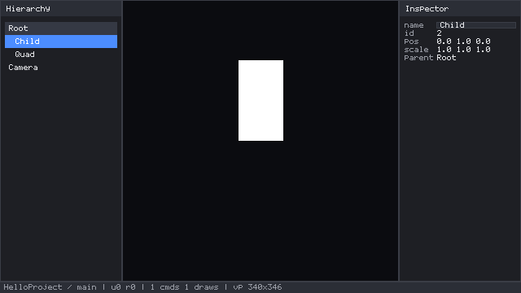

# Editor Shell — CoreXEngine

The graphical editor's composition layer: one editor frame painted with the engine's
own GUI (`corex.gui`), over a session the startup pipeline already prepared. Code in
`src/editor/`, exposed as `corex.editor`.

> Status: **shell and editing model implemented and tested** (docks, hierarchy,
> viewport, inspector with an editable name, status bar, command stack with undo/redo,
> dirty tracking, atomic save, headless frame renderer). The platform parts of an editor
> — a window, a swapchain, real input — are **not** implemented. This document says
> exactly where the line is.

## What the shell is

```
prepared session (scene + camera + assets)   ─┐
rendered surface (RGBA8, the renderer's own) ─┤─► editor.shell.draw ─► one editor frame
input frame + editor state                   ─┘
```

`editor.shell.draw(ctx, state, history, scene, frame) -> bool` paints a complete editor frame
into the GUI context's canvas and returns whether the selection changed. It owns no
scene, no renderer and no surface: everything is borrowed for the duration of the
frame. That is what lets the same call serve a headless tool (`zig build
editor-frame`), a test, and — once the window layer exists — a windowed shell, with no
reimplementation in between.



## Docks

`Dock.compute(canvas_rect)` splits the canvas once per frame into the hierarchy (left),
the viewport (centre), the inspector (right) and the status bar (bottom). The rules are
deliberate:

- Both side panels are **fixed width** (`side_width = 150`). A panel that scales with
  the window makes every label jump, and this surface is text-heavy.
- A panel is admitted only if a viewport of at least `min_viewport_width = 60` still
  fits beside it: both panels, then the hierarchy alone (it is what the user navigates
  with), then neither. **The viewport never disappears** — an editor without one is not
  an editor.
- The docks tile the canvas with no gap and no overlap, which the tests assert.

## Hierarchy

One row per entity, depth-first from the roots, indented by depth, clickable to select
(selection is a stable entity ID, so it survives handle recycling).

Rows come from the hierarchy's own model, `editor/tree.zig`, not from the paint loop:

- **Flat and caller-owned.** `tree.build(scene, list)` writes one `Row{id, depth}` per
  visible line into an array the caller provides; the panel paints that array. Nothing
  allocates, and painting cannot descend into a branch the window has cut off.
- **Bounded work.** The walk stops as soon as the window is full (plus one row, to know
  whether a "more..." hint is needed), so a scene with a hundred thousand entities costs
  the same per frame as one with ten.
- **Depth-limited.** `max_depth = 32` is checked while descending, so a corrupt parent
  chain cannot overflow the stack. The walk is recursive, but its depth is a constant.
- **Scrollable.** `State.tree_offset` is the first painted row; the wheel moves it by
  three rows and it clamps at both ends. Selecting an entity that is off screen
  (`tree.indexOf`, a bounded search) centres the window on it, so a selection restored by
  an undo or moved by a shortcut is never invisible.

Underneath it, each node's children come from `Scene.childIdsInto(parent, out)`, which:

- is **allocation-free** — a single scan of the scene's own records;
- writes **ascending stable IDs**, so the tree does not depend on hash-map visit order;
- keeps the **smallest** IDs when a node has more children than the buffer holds, and
  `Scene.parentIdOf(id)` answers a row's parent without resolving the parent entity;
- never overflows `out`, and when a node has more children than fit it keeps the
  **smallest** IDs, so the visible prefix is deterministic.

`Scene.rootIds` is now defined in terms of the same function, so the two cannot drift.

The row budget (`State.rows_per_frame`, default 24) bounds how much of a large scene one
frame paints; a "more..." hint is shown when it is reached. Scrolling is a later step
(see *Limitations*).

## Viewport

The scene is rendered by the engine's own renderer into an RGBA8 surface — the exact
buffer `raster.Target.color` and `backend.Surface.color` describe — and the shell
samples it into the viewport rect with `Canvas.blitScaled`: nearest-neighbour, clipped
to the destination *and* the canvas, so a viewport smaller than the render is a
downsample of the whole frame rather than a crop, and nothing spills over the panels.

`editor.shell.projectToViewport(view_projection, world, rect)` maps a world position to
a viewport pixel using the **same** matrix the renderer used, so a marker lands on the
pixels the entity was drawn at. A point at or behind the eye (`w <= 0`) or outside the
clip volume returns `null` instead of being divided through onto the wrong side of the
screen.

## Inspector

Name, stable ID, local transform position/scale, the renderable's mesh/material
handles, the camera's field of view, and the parent — read from the scene, never
copied. Values are clipped to their own rect so a long name cannot run into the next
column. With nothing selected the panel says so; an entity with no components still
shows its name, ID and parent.

The **name**, **position** and **scale** are editable; rotation, the renderable handles,
the camera fov and the parent stay read-only.

Every editable field follows the same rule: **typing edits a buffer, Enter commits
through the history, Escape discards.** The buffer is what keeps a half-typed value out
of the scene; the history is what makes the commit one undoable step and marks the
project dirty.

- The **name** commits a `rename` command.
- **`pos`** and **`scale`** are rows of three numeric fields (`src/editor/inspector.zig`).
  A commit builds the *whole* `Transform` — the edited row plus the untouched one — and
  sends it as a **single** `set_component`, so `Ctrl+Z` steps back over the whole value
  the user changed and an axis they did not touch is never rewritten.
- A field that is not a number (`abc`, an empty box, `nan`, an overflow) commits
  **nothing**: the row reverts to what the scene holds, so the panel never claims a value
  the scene does not have. Leaving a field after editing it commits, the way a form does,
  so a typed value is not silently lost.
- The rows reload from the scene when the entity or the underlying values change (undo, a
  command, a selection change) but **never while the user is typing**.

Any focused inspector field holds the keyboard: the frame's shortcuts do not fire, so
`Delete` is a text key there and never "destroy the entity".

## Status bar

Project, scene, save state (`*` = unsaved), undo/redo depth (`u3 r1`), command/draw
count and the viewport size. The render numbers come from the renderer's own
`EngineFrameReport` and the depths from the history, so the bar cannot claim something
that did not happen. The text is **ASCII only**: the built-in font draws anything else
as `?`, which the first render of this bar made embarrassingly obvious.

## Editing model

`src/editor/edit.zig` (`corex.editor.edit`) is the layer that turns a read-only view
into an editor. It imports no GUI and no renderer: the shell drives it, and so do the
tests.

```
Command (a value)  ──apply──►  Scene          + an Entry {command, before} on the stack
                   ◄─undo───   restore(before)
```

**A command is a description, not a closure.** Six arms, all plain data:
`set_component`, `remove_component`, `rename`, `reparent`, `create`, `delete`. Each
names an entity by **stable ID** — not by the generational ECS handle, which gets
recycled — so a command recorded a frame ago still names the right entity.

**Undo is exact, by snapshot.** Before every edit the history captures the entity's full
prior state (name, parent, every schema component). Undo puts that state back. One rule
for all six commands instead of six inverse formulas, and it is what makes the hard case
right: undoing a **delete** restores the entity with its **original stable ID**, its
parent and all its components, so a selection (or an older command) still resolves
afterwards. A schema is the single source of truth — `History(Scene).ComponentValue` is
a comptime union with one *typed* arm per schema component, so a value travels with its
real type instead of as a byte blob.

What the model guarantees, each point covered by a test:

- **Failure changes nothing.** An invalid command records no entry and leaves the scene
  alone; a scene-level failure mid-apply is rolled back from the snapshot taken just
  before, so the scene is never half-edited.
- **`undo` and `redo` allocate nothing** (measured with a counting allocator), which is
  what makes it safe to bind them to a key press inside a frame.
- **A new edit discards the redo tail** — the undone future is unreachable and its
  memory is released.
- **Saving never clears the stacks.** `markSaved` clears the dirty flag only.
- **Redo keeps the original snapshot**, so undo after redo restores the same state.

### Saving

`edit.saveScene(history, scene, io, dir, path, gpa)` stages the serialized document in a
dot-prefixed sibling and renames it over the target. `Scene.save` writes in place, which
is right for a library call and wrong for an editor: a crash mid-write would destroy the
user's only copy. With the staged rename the file on disk is the old project or the new
one, never a truncated mix. A failed save leaves the project **dirty** — "retry the
save" has a meaning only if the flag is honest.

### Shortcuts

Handled once per frame, after the panels are painted, and skipped while a text field
holds focus:

| Key | Action |
| --- | --- |
| `Ctrl+Z` | undo |
| `Ctrl+Y`, `Ctrl+Shift+Z` | redo |
| `Delete` | delete the selected entity (undoable) |
| `Escape` | clear the selection |

They are a convenience over `shell.undo`/`redo`/`deleteSelected`, which are the same
functions a menu or a test calls — the shortcuts add no behaviour of their own. A
selection whose entity no longer resolves (undoing a create, redoing a delete) is
dropped rather than left pointing at nothing.

## Headless frame renderer

```bash
zig build editor-frame -- examples/hello-project/HelloProject.corex out.qoi [selected-id] [dirty]
```

The tool passes a real `edit.History`, so the preview's status bar shows the same save
marker and undo depth a session would; the optional `dirty` argument sets the marker.

`tools/editor_frame.zig` runs the documented startup pipeline (`startup.run`) to
prepare the session, loads the project's render assets, renders one frame of the scene
through `EngineRenderer`, paints the editor around it, and writes the result as QOI
(readable by `assets.image.decodeQoi`, and by any viewer). It draws two passes because
the GUI resolves hit-testing against the previous frame; that is the GUI's documented
behaviour, not a workaround.

## Limitations

- **No window, no swapchain, no real input.** Blocked in this environment (no X11
  headers, no `DISPLAY`). The shell paints into a caller-owned buffer; wiring it to a
  window is `present()` of that same buffer.
- **Rotation and camera fields are read-only.** Rotation needs a field that can express a
  normalized quaternion honestly (or an Euler editor with its own conversion rules), and
  the camera fov is a single value with no angle widget yet. Neither is a model gap: the
  history already carries `set_component` for any component.
- **No scrub/drag on numeric fields.** Values are typed; a drag-to-scrub affordance needs
  pointer-drag state the GUI can already report, but it is a separate interaction.
- **The history is in-memory and per-session.** It is not persisted, and there is no
  "reopen and undo" — deliberate for now.
- **No multi-select, no copy/paste, no grouping.**
- **No expand/collapse per node.** Every row of the visible window is painted; folding a
  subtree is a state model (which IDs are collapsed, restored on reload) that the row
  list does not carry yet. `State.roots_expanded` is the only fold.
- **No keyboard tree navigation.** Clicking selects, the wheel scrolls; arrow keys and
  Tab order are not wired.
- **No create/rename/delete/reparent from the tree.** The commands exist in
  `corex.editor.edit`; the tree has no context menu or inline editor for them yet.
- **No drag/drop, no viewport camera controls, no gizmos.** The camera is whatever the
  scene authors.
- **No keyboard focus traversal.** Clicking a row selects; Tab order is not
  implemented (the GUI layer reports Tab, nothing consumes it yet).
- **Fixed dock widths, no resizable splitters, no docking/re-docking.**
- **One viewport, one scene.** Multi-scene editing and tabs are out of scope for now.
